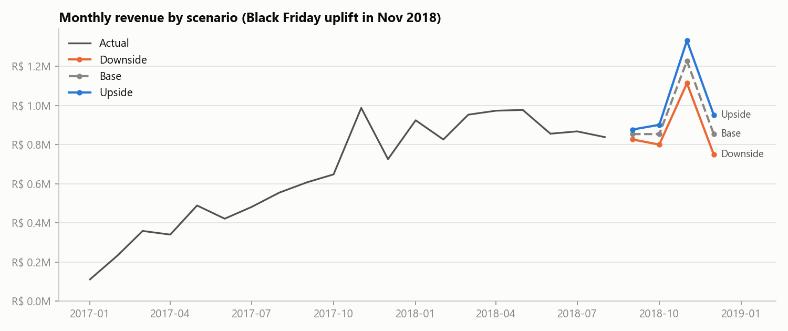
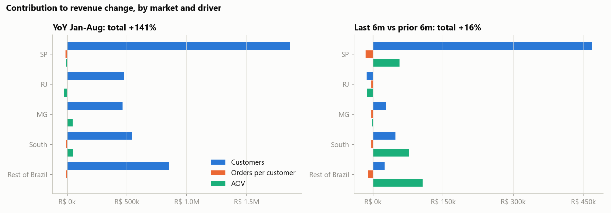
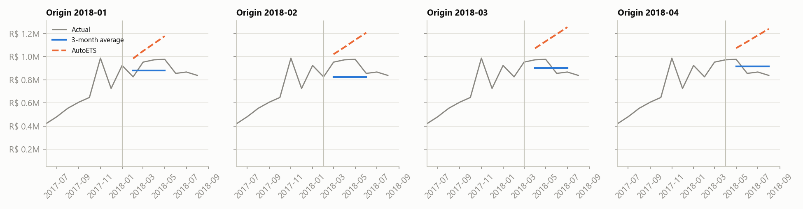
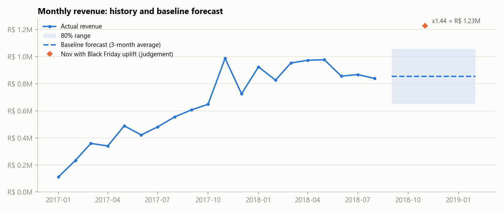
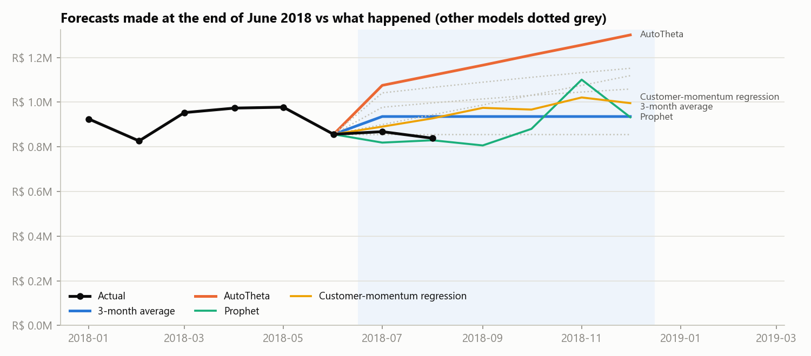
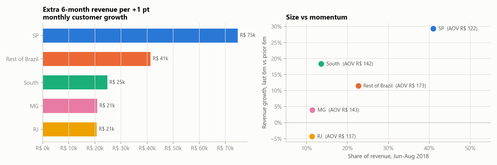
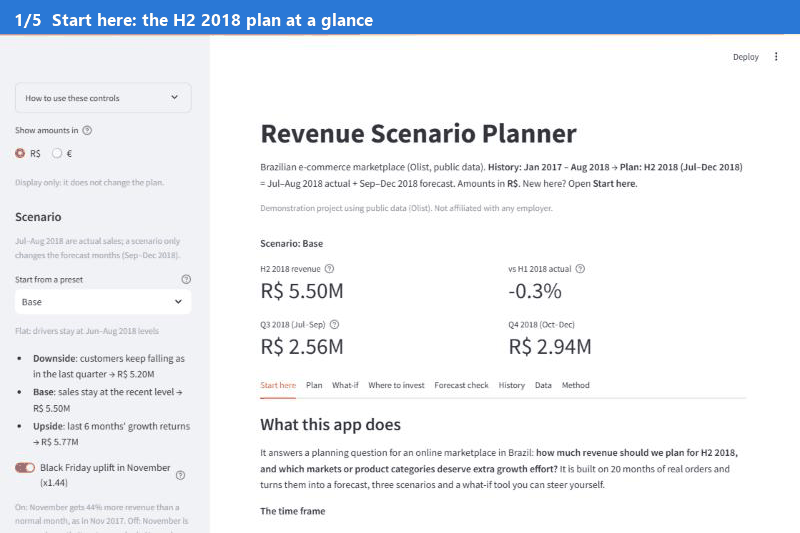

# Revenue Forecast & Scenario Planner

[](https://github.com/jessicaayivi/revenue-forecast-scenario-planner/actions/workflows/tests.yml)
[](https://revenue-scenario-planner-jessica-ayivi.streamlit.app/)

**▶ Try the live app: [revenue-scenario-planner-jessica-ayivi.streamlit.app](https://revenue-scenario-planner-jessica-ayivi.streamlit.app/)**
(no install needed: pick a scenario, test a what-if, explore the history).

> Demonstration project using public data (Olist). Not affiliated with any employer.

**Business question:** What revenue should we plan for H2 2018, and which markets or categories should get
extra growth investment?

**Data:** 96,478 delivered orders from Olist, a Brazilian e-commerce marketplace, Jan 2017 – Aug 2018.
The plan covers **H2 2018 (Jul–Dec 2018)**: Jul–Aug are actuals already in the data, Sep–Dec is forecast,
the usual "actuals to date + forecast" outlook.

## The answer

- **Plan on R$ 5.50M** for H2 2018: R$ 2.56M in Q3 (of which R$ 1.71M is already booked in Jul–Aug) and
  R$ 2.94M in Q4. That is flat on H1 2018 (-0.3%) and +37% on H2 2017: the Jun–Aug 2018 run rate held for
  Sep–Dec, plus a Black Friday uplift in November.
- **Hold a downside of R$ 5.20M.** Customer numbers fell 9% in Jun–Aug; if that continues, revenue drops
  R$ 0.30M below plan. The upside, if the last 6 months' momentum returns, is R$ 5.77M.
- **Invest in customer acquisition in SP first.** It is the biggest market (41% of revenue) and the only one with
  strong recent customer growth: one extra point of monthly customer growth there is worth R$ 35k over Sep–Dec.
- **Protect order value in South and Rest of Brazil**, hold spend in RJ (revenue down 4%), and back the categories
  with momentum: health & beauty, housewares and auto.

The full reasoning, a scenario table by market and the signals that should trigger a re-plan are in the
**[decision memo](docs/decision_memo.md)**.



## What I found

**1. Growth came from new customers, not repeat buyers.** Revenue rose 141% from Jan–Aug 2017 to Jan–Aug 2018,
and customer numbers explain 99% of that rise. Only 3% of customers ordered more than once, so retention is not a
lever on this horizon.



**2. The growth had stopped.** Revenue was flat from March 2018, and in Jun–Aug monthly customers fell in every
market. Every trend model I backtested carried 2017's growth forward and over-forecast by 16–23%.



**3. A flat forecast was the most accurate, out of ten models.** I tested five revenue-only models, a
driver-based model (customers × orders per customer × AOV), a regression on customer momentum, Prophet on daily
data (weekly and yearly seasonality, Black Friday), Prophet with forecast KPIs as regressors and Prophet with
leading indicators (late deliveries, cancellations, new-customer share, lagged 2 months). The 3-month average had
the lowest backtest error (10.4% WAPE across the total and 5 markets), so it is the baseline. Prophet with KPI
regressors mostly rebuilds customers × orders × AOV, so it is only as good as those KPI forecasts; Prophet's yearly
pattern was unstable with under two years of history. Growth is added through explicit, named scenarios rather
than hidden inside a trend line.



**4. Would it have worked? A real-world check.** Planning as if it were the end of June 2018, the backtest
would have picked Prophet with leading indicators, which then forecast Jul–Aug +22% too high: revenue stopped
growing in July, a turning point no model saw coming. Late deliveries had spiked to 14–19% in Feb–Mar 2018 and
customer numbers were already falling in 4 of 5 markets, but not clearly enough for any model to act on. That is
why the plan is flat and comes with customer-based triggers.



**5. Markets differ in how they grow.** SP grew through customers; South and Rest of Brazil grew through higher
order values; RJ shrank.



## The scenario planner

An interactive Streamlit app. A **Start here** tab explains the question, the time frame (history Jan 2017 –
Aug 2018, plan H2 2018 = Jul–Aug actual + Sep–Dec forecast), a map of the five markets across Brazil and how to
use the app; a **Forecast check** tab compares the ten models; a **History** tab charts every metric (revenue,
customers, AOV, late deliveries...) by market and category with downloadable tables; a **Data** tab explains the
source files, the cleaning and every term; a **Method** tab documents every step. Amounts can be shown in R$ or € (constant ECB 2018 average,
R$ 4.3085 = €1). Pick a preset, adjust customer and order-value growth per market, toggle the Black
Friday uplift, and see the plan by quarter and market. The **What-if** tab tests a single hypothesis, such as
"+10% customers in SP from October" or "+5% items per order": it shows the revenue impact by quarter and market,
and where the same change would be worth most. A **price vs volume** mode raises or cuts prices, lets customers
respond with an elasticity you choose, and shows the break-even point. It uses the same engine as the notebooks, so the numbers always match.



Open it online: **[revenue-scenario-planner-jessica-ayivi.streamlit.app](https://revenue-scenario-planner-jessica-ayivi.streamlit.app/)**

## How it works

| Stage | What | Where |
|---|---|---|
| 1. Clean | Join orders, items, customers and products; delivered orders only; data-quality report | `src/prepare.py`, `notebooks/01_exploration.ipynb` |
| 2. Drivers | Revenue = customers × orders per customer × AOV per market, with an exact (LMDI) split of growth by driver | `src/drivers.py`, `notebooks/02_drivers.ipynb` |
| 3. Forecast | 10 models (incl. driver-based, KPI regression, Prophet with and without regressors) backtested from 4 starting points; best chosen by error across total and markets; real-world check planning from June 2018 | `src/forecast.py`, `notebooks/03_forecast.ipynb` |
| 4. Scenarios | Downside / base / upside from observed growth rates; revenue sensitivity by market; category scorecard | `src/scenarios.py`, `notebooks/04_scenarios.ipynb`, `app/` |
| 5. Memo | Decision memo generated from the outputs, with checks that each claim still holds | `src/memo.py`, `docs/decision_memo.md` |

## Decisions and trade-offs

- **Revenue = item price on delivered orders.** Freight is excluded (a delivery charge, not product revenue); 2,963
  non-delivered orders (3%) are excluded.
- **20 months of history, no yearly seasonality.** Only Jan 2017 – Aug 2018 has stable volume, so there is no
  second year to learn seasonality from; Prophet, which tries, was unstable. Black Friday
  (×1.44, from one November) is a labelled assumption, kept separate so it can be switched off.
- **Regressing revenue on its own components doesn't forecast.** Revenue = customers × orders per customer × AOV
  exactly, so a regression on them fits perfectly but needs next month's KPIs to predict next month. The honest
  version uses lagged KPIs (customer momentum) or KPI forecasts from other models as regressors; both are among the ten models tested.
- **Model designs fixed before the check.** The richer models were specified before seeing how they did on
  Jul–Aug 2018, and none was tuned afterwards.
- **Model chosen across markets, not just the total.** On total revenue alone the two best models were tied;
  the plan is set per market, so market accuracy decided it.
- **Symmetric uncertainty range.** The backtest months were growth months, so past errors all leaned one way.
  Carrying that lean forward would assume growth the latest data no longer shows.
- **Scenarios from the data, not from guesses.** Each preset applies a growth rate measured in the history.
- **Revenue sensitivity, not return on investment.** There is no cost or marketing data, so the "where to
  invest" view shows where growth is worth most, not what it would cost.
- **Every number is reproducible.** The memo is generated from the outputs, and the tests check the data,
  the maths (drivers multiply back to revenue, markets add up to the total), the backtest (no look-ahead), the app
  and the memo's claims.

## Run it

Download the [Olist CSVs](https://www.kaggle.com/datasets/olistbr/brazilian-ecommerce) into `data/raw/`, then:

```bash
pip install -r requirements.txt
python -m src.run_all                 # all tables, forecast, scenarios and the memo -> data/processed/, docs/
python -m pytest -q                   # data, maths, backtest, app, memo and README checks
streamlit run app/streamlit_app.py    # interactive scenario planner
```

Tested on Python 3.12. Main libraries: pandas, statsforecast, Prophet, matplotlib, plotly, Streamlit.

## Repository

```
app/            Streamlit scenario planner
data/raw/       Olist CSVs (not committed)
data/processed/ Tidy tables and model outputs
docs/           Decision memo and charts
notebooks/      01 exploration, 02 drivers, 03 forecast, 04 scenarios
src/            Pipeline: prepare, drivers, forecast, scenarios, memo, run_all
tests/          Data, driver, forecast, scenario, app, memo and README tests
```

## Limits

Public snapshot of one marketplace; 20 months of history and a single November; no costs, margins or marketing
spend; markets are customer locations, not sales teams. The plan dates (2018) reflect the dataset, not today.

## Credits

Data: [Olist Brazilian E-Commerce Public Dataset](https://www.kaggle.com/datasets/olistbr/brazilian-ecommerce),
licensed CC BY-NC-SA 4.0. Credit: Olist.
