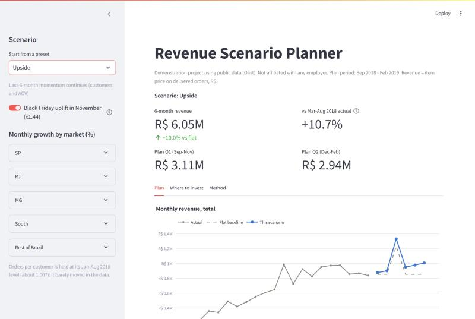

# Revenue Forecast & Scenario Planner

> Demonstration project using public data (Olist). Not affiliated with any employer.

**Business question:** What revenue should we plan for the next 2 quarters, and which markets or
categories should get extra growth investment?

**Data:** 96,478 delivered orders from Olist, a Brazilian e-commerce marketplace, Jan 2017 – Aug 2018.
The plan covers Sep 2018 – Feb 2019.

## The answer

- **Plan on R$ 5.50M** for the 6 months: R$ 2.94M in Sep–Nov and R$ 2.56M in Dec–Feb. That is a flat plan at
  the Jun–Aug 2018 run rate plus a Black Friday uplift in November.
- **Hold a downside of R$ 4.92M.** Customer numbers fell 9% in Jun–Aug; if that continues, revenue drops
  R$ 0.58M below plan. The upside, if the last 6 months' momentum returns, is R$ 6.05M.
- **Invest in customer acquisition in SP first.** It is the biggest market (41% of revenue) and the only one with
  strong recent customer growth: one extra point of monthly customer growth there is worth R$ 75k over 6 months.
- **Protect order value in South and Rest of Brazil**, hold spend in RJ (revenue down 4%), and back the categories
  with momentum: health & beauty, housewares and auto.

The full reasoning, a scenario table by market and the signals that should trigger a re-plan are in the
**[decision memo](docs/decision_memo.md)**.


## What I found

**1. Growth came from new customers, not repeat buyers.** Revenue rose 141% from Jan–Aug 2017 to Jan–Aug 2018,
and customer numbers explain 99% of that rise. Only 3% of customers ordered more than once, so retention is not a
lever on this horizon.


**2. The growth had stopped.** Revenue was flat from March 2018, and in Jun–Aug monthly customers fell in every
market. Every trend model I backtested carried 2017's growth forward and over-forecast by 18–28%.


**3. A flat forecast was the most accurate.** A 3-month average had the lowest backtest error (12.3% WAPE across
the total and 5 markets), so it is the baseline. Growth is then added through explicit, named scenarios rather
than hidden inside a trend line.


**4. Markets differ in how they grow.** SP grew through customers; South and Rest of Brazil grew through higher
order values; RJ shrank.


## The scenario planner

An interactive Streamlit app: pick a preset, adjust customer and order-value growth per market, toggle the Black
Friday uplift, and see the plan by quarter and market. It uses the same engine as the notebooks, so the numbers
always match.



## How it works

| Stage | What | Where |
|---|---|---|
| 1. Clean | Join orders, items, customers and products; delivered orders only; data-quality report | `src/prepare.py`, `notebooks/01_exploration.ipynb` |
| 2. Drivers | Revenue = customers × orders per customer × AOV per market, with an exact (LMDI) split of growth by driver | `src/drivers.py`, `notebooks/02_drivers.ipynb` |
| 3. Forecast | 5 models backtested from 4 starting points, 6 months ahead each; best chosen by error across total and markets | `src/forecast.py`, `notebooks/03_forecast.ipynb` |
| 4. Scenarios | Downside / base / upside from observed growth rates; revenue sensitivity by market; category scorecard | `src/scenarios.py`, `notebooks/04_scenarios.ipynb`, `app/` |
| 5. Memo | Decision memo generated from the outputs, with checks that each claim still holds | `src/memo.py`, `docs/decision_memo.md` |

## Decisions and trade-offs

- **Revenue = item price on delivered orders.** Freight is excluded (a delivery charge, not product revenue); 2,963
  non-delivered orders (3%) are excluded.
- **20 months of history, no seasonality.** Only Jan 2017 – Aug 2018 has stable volume, so there is no second
  year to learn seasonality from. Black Friday (×1.44, from one November) is a labelled assumption, kept separate
  so it can be switched off.
- **Model chosen across markets, not just the total.** On total revenue alone the two best models were tied;
  the plan is set per market, so market accuracy decided it.
- **Symmetric uncertainty range.** The backtest months were growth months, so past errors all leaned one way.
  Carrying that lean forward would assume growth the latest data no longer shows.
- **Scenarios from the data, not from guesses.** Each preset applies a growth rate measured in the history.
- **Revenue sensitivity, not return on investment.** There is no cost or marketing data, so the "where to
  invest" view shows where growth is worth most, not what it would cost.
- **Every number is reproducible.** The memo is generated from the outputs, and the tests check the data,
  the maths (drivers multiply back to revenue, markets add up to the total), the backtest (no look-ahead), the app
  and the memo's claims.

## Run it

Download the [Olist CSVs](https://www.kaggle.com/datasets/olistbr/brazilian-ecommerce) into `data/raw/`, then:

```bash
pip install -r requirements.txt
python -m src.run_all                 # all tables, forecast, scenarios and the memo -> data/processed/, docs/
python -m pytest -q                   # data, maths, backtest, app, memo and README checks
streamlit run app/streamlit_app.py    # interactive scenario planner
```

Tested on Python 3.12. Main libraries: pandas, statsforecast, matplotlib, plotly, Streamlit.

## Repository

```
app/            Streamlit scenario planner
data/raw/       Olist CSVs (not committed)
data/processed/ Tidy tables and model outputs
docs/           Decision memo and charts
notebooks/      01 exploration, 02 drivers, 03 forecast, 04 scenarios
src/            Pipeline: prepare, drivers, forecast, scenarios, memo, run_all
tests/          Data, driver, forecast, scenario, app, memo and README tests
```

## Limits

Public snapshot of one marketplace; 20 months of history and a single November; no costs, margins or marketing
spend; markets are customer locations, not sales teams. The plan dates (2018–2019) reflect the dataset, not today.

## Credits

Data: [Olist Brazilian E-Commerce Public Dataset](https://www.kaggle.com/datasets/olistbr/brazilian-ecommerce),
licensed CC BY-NC-SA 4.0. Credit: Olist.
