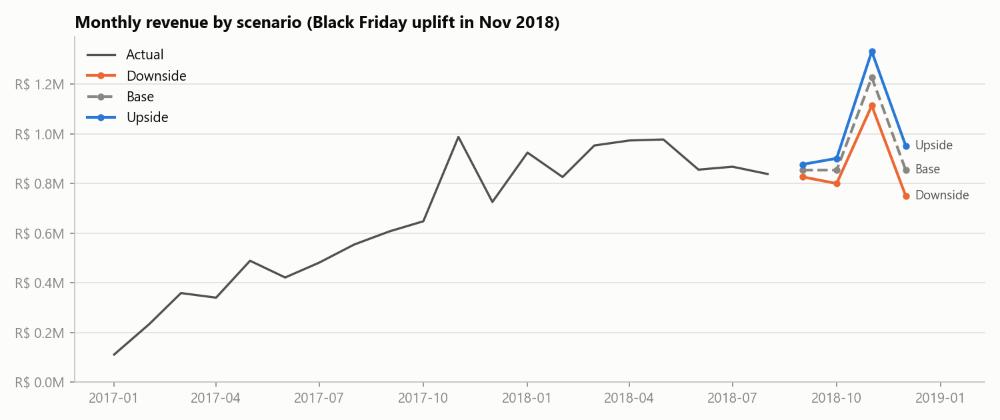
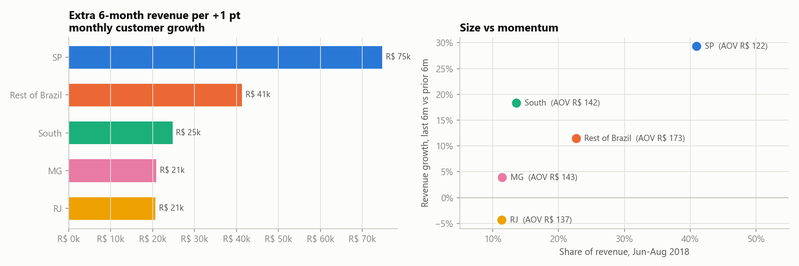

# Decision memo: revenue plan for Sep 2018 – Feb 2019

*Demonstration project using public data (Olist). Not affiliated with any employer.
Generated by `python -m src.memo` from the pipeline outputs; every figure below comes from `data/processed/`.*

**Question:** what revenue should we plan for the next 2 quarters, and which markets or categories should get
extra growth investment?

## Recommendation

1. **Plan on R$ 5.50M for Sep 2018 – Feb 2019**: R$ 2.94M in Plan Q1 (Sep–Nov) and
   R$ 2.56M in Plan Q2 (Dec–Feb). This is a flat plan at the Jun–Aug 2018 run rate
   (R$ 854k a month) plus a Black Friday uplift in November.
2. **Hold a downside case of R$ 4.92M** (R$ 0.58M below plan). It
   assumes only that the customer decline seen in Jun–Aug carries on. It is not a stress test.
3. **Put extra customer-acquisition effort into SP first.** As the largest market it is the largest lever: one
   extra point of monthly customer growth there is worth R$ 75k over 6 months, 3.6× the
   same lift in RJ. It also has the momentum: SP delivered 68% of the last 6 months' growth.
4. **In South and Rest of Brazil, protect order value.** Their recent growth came mostly from AOV
   (South +11%, Rest of Brazil +10%);
   Rest of Brazil has the highest AOV at R$ 173.
5. **Don't add spend in RJ until the decline is understood** (revenue -4%
   over the last 6 months). MG is flat (+4%).
6. **Categories: back health beauty (+55%), housewares (+91%) and auto (+43%)**; review
   computers accessories (-12%) and cool stuff (-35%).

## The plan in numbers

| Scenario | Assumes | Plan Q1 (Sep–Nov) | Plan Q2 (Dec–Feb) | 6 months | vs Mar–Aug 2018 |
|---|---|---|---|---|---|
| Downside | Jun–Aug customer decline continues | R$ 2.74M | R$ 2.18M | R$ 4.92M | -10% |
| **Base (plan)** | Drivers stay at Jun–Aug 2018 levels | **R$ 2.94M** | **R$ 2.56M** | **R$ 5.50M** | +1% |
| Upside | Last-6-month momentum continues | R$ 3.11M | R$ 2.94M | R$ 6.05M | +11% |

All three include the Black Friday uplift (×1.44 on November, worth
R$ 0.37M in the base case). Without it the base is R$ 5.13M.

| Market | Share of revenue | Base, 6 months | Downside | Upside | Revenue, last 6m vs prior 6m |
|---|---|---|---|---|---|
| SP | 41% | R$ 2,253k | R$ 2,121k | R$ 2,634k | +29% |
| RJ | 11% | R$ 624k | R$ 525k | R$ 610k | -4% |
| MG | 11% | R$ 630k | R$ 533k | R$ 646k | +4% |
| South | 14% | R$ 747k | R$ 623k | R$ 826k | +18% |
| Rest of Brazil | 23% | R$ 1,245k | R$ 1,121k | R$ 1,334k | +12% |

## Why

- **Growth came from new customers, not from customers coming back.** Customers explain
  99% of the +141%
  revenue rise from Jan–Aug 2017 to Jan–Aug 2018. Only 3% of customers ordered more than once;
  orders per customer sits at 1.007. Retention is not a revenue lever on this horizon.
- **The growth has stalled.** Monthly customers in Jun–Aug 2018 were -9%
  vs Mar–May, and down in every market. A plan that extends 2017's growth would be wrong: in the backtest, the
  trend models over-forecast by +18% to +28%.
- **A flat forecast is the most accurate one we tested.** The 3-month average had the lowest average error
  (WAPE 12.3% across the total and 5 markets, vs 23.7% for the best
  trend model). Its 80% range on the total is ±24% a month.
- **SP is where size and momentum meet.** 41% of revenue and
  +27% customers over the last 6 months, the only market with strong customer growth.

## What would change the plan

Check average monthly customers for Sep–Oct 2018 against the base of 6,158. Each threshold sits
halfway between the base path and the other scenario's path:

- **Below 6,015**: the decline is continuing. Re-plan on the downside (R$ 4.92M).
- **Above 6,257**: momentum is back. Move towards the upside (R$ 6.05M).
- **November**: the uplift rests on one Black Friday (2017). Confirm promotion plans with the business before
  committing the R$ 0.37M.

## Limits

- 20 months of usable history (Jan 2017 – Aug 2018) and a single November, so no seasonality is modelled.
- No cost, margin or marketing data: "where to invest" is **revenue sensitivity, not return on investment**.
- Revenue is item price on delivered orders (2,963 non-delivered orders excluded; freight excluded).
- Olist is a marketplace: these markets are customer locations, not sales teams.

## How this was built

Data cleaning and checks (`src/prepare.py`), driver tree (`src/drivers.py`), backtested forecast
(`src/forecast.py`) and scenarios (`src/scenarios.py`), with notebooks `01`–`04` and an interactive planner
(`streamlit run app/streamlit_app.py`). Reproduce everything with `python -m src.run_all`.
